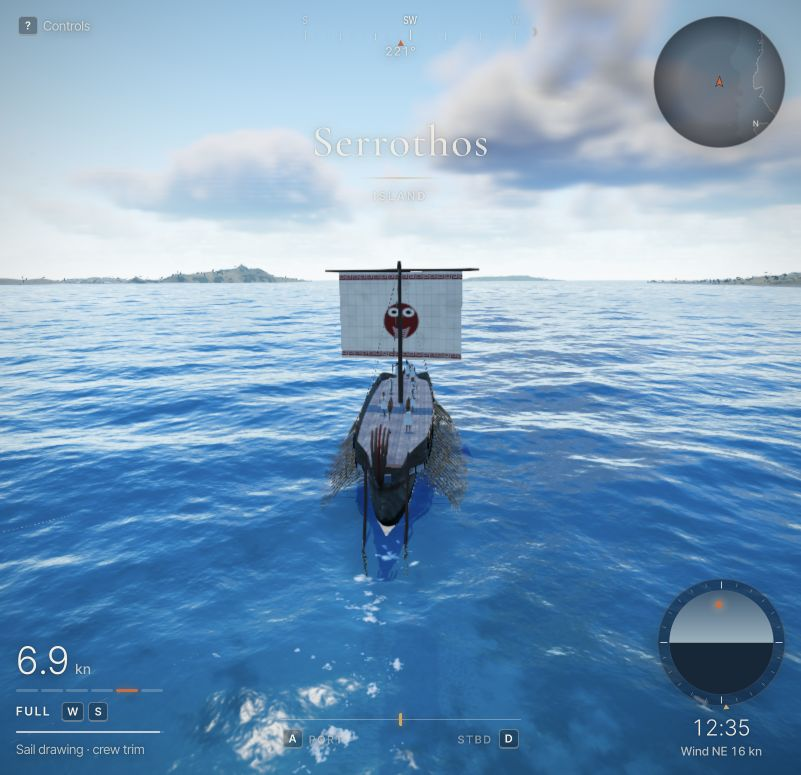

# Sailing browser verification

The user explicitly requested browser verification after the initial source/headless signoff.
The lead tested the production build in the Codex in-app browser at `http://127.0.0.1:5177`,
High quality, 801 × 775 viewport. Interaction used native keyboard input. This is local evidence
from one browser and machine, not a cross-browser or frame-rate certification.

## Method

Six opt-in `?dev&hud=1&sailingReview=…` scenes place the actual ship in a deep-water corridor.
Wind, waves, crew, rigid-body integration, rendering and input use the normal application paths.
The following-wind scenes prime the same physics for 90 seconds before rendering; beam/headwind
prime for 30 seconds and calm for 60. All continue running while inspected. The calm scene sets
true wind to zero, with Full rowing and the sail deployed.

`#sailing-review-state` reports the actual physics snapshots and shader/yard state through a
read-only DOM record. [Raw observations](sailing-browser/evidence.json) retain the sampled times,
forces, crew work, grounding, controls and rendered state. Screenshots and telemetry are successive
live observations, so their numerical readouts can differ slightly.

## Propulsion and loading

| Live scene | Observed state | Relevant response |
| --- | --- | --- |
| Wind only | Oars Up, drawing sail, 3.30 kn | Positive sail drive; zero active rowing power |
| Rowing only | Full, furled sail, 6.03 kn | Exactly zero sail drive/load; active rowing work |
| Combined | Full, drawing sail, 6.94 kn | Positive sail drive and active rowing work together |
| Headwind | Oars Up, sail aback, −2.63 kn signed forward speed | Negative sail drive and reversed pressure sign; ship drifts astern |
| Beam wind | Crew-braced sail, drawing | 3.04 kN sideforce and −10.67° instantaneous heel; visible heel/leeway |
| Manual beam trim | Luffing | Fill falls to −0.328, flutter rises to 0.672, pressure falls to −0.030 |
| True calm with rowing | Full, sail aback, 6.48 kn; footer shows 0 kn true wind | Moving ship produces 3.31 m/s apparent air and −603 N sail drive |

These are single live samples in moving waves/gusts, not controlled averages or historical vessel
measurements. Use [the deterministic validation](sailing-validation.md) for comparative speeds,
rowing-work reduction, convergence and stability. The normal HUD displays speed magnitude;
the headwind telemetry records signed forward speed.

## Native controls and rendering

- **G:** full → half changes target to 0.5; actual deployment changes gradually. The visible cloth
  shortens to half height. Selection while brailing keeps target at zero.
- **F:** brails to zero, then restores the selected full area after G changed that selection while
  lowered. The final brailed cloth and shader deployment both read zero.
- **J/L:** enter manual trim from the current yard angle and turn the actual yard in opposite
  directions. **K** restores crew trim. Manual adjustment produces a visible luffing state.
- **V:** still operates the spyglass (sampled zoom 0.811), preserving the half-sail target and
  manual trim mode.
- **C:** returns from chase to the helm; G also works there.
- **H:** full → minimal → off → full synchronizes the visible HUD classes and density. Minimal
  retains sail condition; off hides the interface. The prior saved density is restored after testing.
- Drawing, half sail, brailing, aback and luffing labels appear in the live HUD. Beam-wind leeway
  appears in full density. In-range wind ticks and off-tape edge cues are visible.
- Every recorded rendered deployment, yard angle, pressure and flutter lies between the same
  physics step's previous/current values. All recorded body states are finite and grounding is zero.
- The recorded warning/error console queries are empty, including after combined propulsion,
  reversed pressure, luffing and helm controls. No shader compilation or WebGL error was observed.

A review-harness defect was corrected during testing: forcing the density field to full could
leave a previously saved `none` CSS class. The fixture now synchronizes its HUD classes without
changing saved preferences. This correction only affects the opt-in review setup.

Typecheck and production build passed after the fixture changes. High-quality GPU timing samples
varied roughly 23–43 ms across the recorded states; they do not establish a whole-frame or sustained
FPS figure. No renderer tuning or broad performance claim is part of this verification.

## Captures

Other views: [wind only](sailing-browser/wind-only.jpg), [rowing only](sailing-browser/row-only.jpg),
[half sail](sailing-browser/half-sail.jpg), [brailed](sailing-browser/brailed.jpg),
[beam wind](sailing-browser/beam.jpg), [luffing](sailing-browser/luffing.jpg),
[headwind](sailing-browser/headwind.jpg), [calm](sailing-browser/calm.jpg),
[minimal HUD](sailing-browser/minimal.jpg), and [helm](sailing-browser/helm.jpg).
